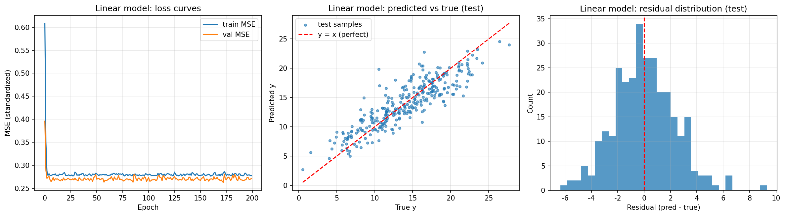

# 第二题 2.1　线性模型　实验报告

## 一、数据

- 数据来源：`sklearn.datasets.make_friedman1(n_samples=1500, n_features=10, noise=1.0, random_state=42)`
- 规模：1500 条样本 × 10 个特征；标签 `y` 分布为 min 0.526 / max 28.942 / mean 14.296 / std 4.879
- 划分：训练 900 / 验证 300 / 测试 300（先切 40% 当临时集，再对半切成验证与测试）
- 预处理：输入特征与标签都做 Z-score 标准化；`StandardScaler` **只在训练集上 fit**，再 `transform` 验证集和测试集，避免测试集信息泄漏

## 二、模型结构

```python
class LinearRegressor(nn.Module):
    def __init__(self, in_features):
        super().__init__()
        self.linear = nn.Linear(in_features, 1)

    def forward(self, x):
        return self.linear(x)
```

- 只有一层 `nn.Linear(10, 1)`，**没有隐藏层、没有激活函数**（题目要求的"不含隐藏层"）
- 参数量：**11 个**（10 个权重 + 1 个偏置）
- 等价数学形式：`y_hat = w1*x1 + w2*x2 + ... + w10*x10 + b`

## 三、训练设置

| 项目 | 设置 |
|---|---|
| 损失函数 | MSELoss |
| 优化器 | Adam，学习率 0.01 |
| batch_size | 64（900 条训练数据，每轮约 15 个 batch） |
| epochs | 200 |
| 模型选择 | 每个 epoch 在验证集上算一次 MSE，保留验证集最优的那组参数（早停） |

## 四、测试结果

| 数据 | MSE | RMSE | MAE | R² |
|---|---|---|---|---|
| 训练集（900） | 6.6981 | 2.5881 | 2.0506 | 0.7202 |
| 验证集（300） | 6.2873 | 2.5074 | 2.0107 | 0.7358 |
| **测试集（300）** | **5.3770** | **2.3188** | **1.8174** | **0.7694** |

主要指标取 **RMSE 和 R²**：RMSE 与 y 同量纲（y 的标准差是 4.83），2.3188 表示"平均差 2.32 个单位"；R² = 0.7694 表示模型解释了约 77% 的方差。

## 五、可视化



图里三个子图的意义：
- **左：训练/验证 MSE 曲线**——两条线在几轮之后左右就基本贴平，之后再训也不降；
- **中：预测值 vs 真实值散点**——点云是一条**水平带**，明显没有贴住红色 `y = x` 对角线，说明模型把差距很大的真实值都预测到了中间区域；
- **右：残差分布**——`预测 − 真实` 分布较宽，且与真实值大小相关（大 y 处系统性偏低）。

## 六、结果分析

1. **这是典型的欠拟合，不是训练不够**。训练 MSE 从第 40 轮起就停在 0.279 左右，再训 160 轮也只降到 0.277；最好的验证 MSE 只有 0.2627。继续加 epoch、调学习率都不会有明显改善，因为瓶颈在**模型表达能力**，不在训练过程。
2. **训练误差（RMSE 2.5881）甚至略高于测试误差（2.3188）**。这不是"学得好"，而是模型容量太小、根本到不了会过拟合的程度，两者的差异只是划分带来的随机波动。
3. **从学到的权重能看出它为什么学不动**：标准化空间下的权重为
   `[0.372, 0.410, -0.004, 0.569, 0.330, -0.024, 0.023, 0.027, 0.017, 0.029]`
   - 后 5 个特征（x6~x10）在真实函数里完全无关，模型学到的权重也确实接近 0；
   - x3 的真实作用是二次项 `20(x3-0.5)²`，关于 0.5 对称，线性项平均后互相抵消，所以权重约等于 0；
   - x1、x2、x4、x5 权重最大，但真实函数里 x1、x2 是通过 `sin(π·x1·x2)` 的**乘积交互**起作用的，线性模型只能各给一个固定权重，表达不了这种"x1 大时 x2 的影响才明显"的关系。
4. **结论**：题目给的数据本身是非线性 + 特征交互的，而"不含隐藏层的线性模型"只能做特征的线性加权，误差主要来自**模型偏差**而不是数据或训练。改进方向只能是换结构（见 2.2 的 MLP）。
