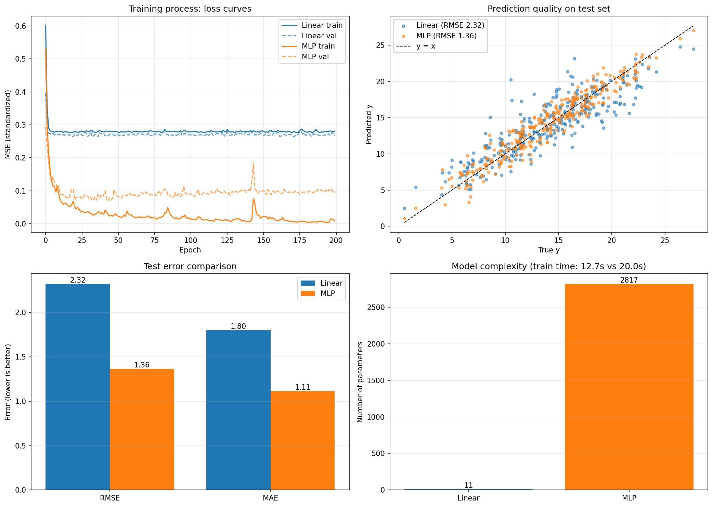

# 第二题 2.2　全连接神经网络（MLP）与线性模型对比　实验报告

## 一、数据

与 2.1 完全相同：`make_friedman1(n_samples=1500, n_features=10, noise=1.0, random_state=42)`，用同一个 `SEED=42` 做同样的训练/验证/测试划分和标准化，保证两个模型面对的是同一份数据。

## 二、模型结构

```python
class MLPRegressor(nn.Module):
    def __init__(self, in_features, hidden1=64, hidden2=32):
        super().__init__()
        self.net = nn.Sequential(
            nn.Linear(in_features, hidden1),
            nn.ReLU(),
            nn.Linear(hidden1, hidden2),
            nn.ReLU(),
            nn.Linear(hidden2, 1)          # 回归输出层，不加激活
        )

    def forward(self, x):
        return self.net(x)
```

| 层 | 形状 | 说明 |
|---|---|---|
| Linear + ReLU | 10 → 64 | 扩维 + 非线性 |
| Linear + ReLU | 64 → 32 | 降维 + 非线性 |
| Linear | 32 → 1 | 输出层，不加激活（回归要输出任意实数） |

- MLP 参数量：**2817**；线性模型（对照基线，与 2.1 完全相同）：**11**，约 256 倍
- 两个模型的训练配置完全一致：MSELoss、Adam(lr=0.01)、batch_size=64、epochs=200、同一随机种子

## 三、测试结果

| 模型 | 参数量 | 测试集 MSE | 测试集 RMSE | 测试集 MAE | 测试集 R² |
|---|---|---|---|---|---|
| 线性模型 | 11 | 5.3755 | 2.3185 | 1.7984 | 0.7694 |
| **MLP (64-32)** | 2817 | **1.8562** | **1.3624** | **1.1138** | **0.9204** |

- 测试 RMSE：2.3185 → 1.3624，**降低 41.2%**
- 测试 R²：0.7694 → 0.9204
- 测试 MAE：1.7984 → 1.1138

## 四、两个模型的对比表

题目要求把主要结果整理到同一张表格，下面是完整对比（程序运行后同时导出为 `q2_model_comparison.csv`）：

| 对比项 | 线性模型 | MLP (64-32) |
|---|---|---|
| 隐藏层 | 无 | 2 层（64, 32）+ ReLU |
| 参数量 | 11 | 2817（约 256 倍） |
| 训练耗时（本次运行） | 12.7 秒 | 20.0 秒 |
| 训练集 RMSE | 2.5725 | 0.7088 |
| 测试集 MSE | 5.3755 | 1.8562 |
| 测试集 RMSE | 2.3185 | 1.3624 |
| 测试集 MAE | 1.7984 | 1.1138 |
| 测试集 R² | 0.7694 | 0.9204 |
| 最终训练 MSE（标准化空间） | 0.2807 | 0.0082 |
| 最优验证 MSE（标准化空间） | 0.2635 | 0.0699 |

> 说明：最后两行的 MSE 是在标准化空间里算的（标签做过 Z-score），数值比前面的原始尺度指标小，两类数字不能直接横向比较大小。

## 五、可视化



四个子图：
- **左上 loss 曲线**：线性模型（蓝）40 轮内就贴平在 0.28；MLP（橙）的训练 loss 持续下降到 0.008，验证 loss 停在 0.07~0.10 并开始抖动 → 训练与验证之间出现缝隙；
- **右上 预测 vs 真实**：橙点（MLP）紧贴 `y = x` 对角线，蓝点（线性）散成一片水平带；
- **左下 误差柱状**：RMSE 与 MAE 两个指标上 MLP 都明显更低，方向一致，不是单一指标的偶然；
- **右下 参数量**：11 vs 2817，复杂度差两个数量级。

## 六、我对两个模型差异的理解

1. **差异的根源是"有没有非线性"**。线性模型的假设空间只有 `y = XW + b`；MLP 在两层线性变换之间插入了 ReLU，因此能表达特征之间的乘积、分段线性组合等非线性关系。
2. **数据的关键结构恰好是线性模型表达不了的**。`make_friedman1` 里 `sin(π·x1·x2)` 是 x1、x2 的交互项，`20(x3-0.5)²` 是二次项。多层 ReLU 组合可以逼近这些项，所以测试误差明显下降。
3. **两者的失败模式不同**：
   - 线性模型是**高偏差**：训练误差≈测试误差，且都很大，怎么训都不会更好（loss 曲线早早贴平）；
   - MLP 是容量足够、**开始有过拟合迹象**：训练集 RMSE 0.7088 远小于测试集 1.3624，验证 loss 后期回升。所以正确说法是"容量够了，但需要早停/正则化来约束"（本实验已经用"取验证集最优参数"做了早停）。
4. **复杂度不是免费的**：参数量翻了 256 倍、训练时间也明显更长（耗时受机器负载影响，每次运行不同），才换来 41% 的误差下降。数据量足够、任务非线性时这笔交易划算；如果数据少、噪声大，同样的 MLP 就会过拟合，收益会小很多（见延伸思考 2）。
5. **实践启发**：建模前先判断任务是否线性。如果特征与目标之间存在交互/非线性，从线性模型起步会陷入"结构性欠拟合"，此时调学习率、加 epoch 都是白费力气；反过来，如果数据本身接近线性，上大网络只会增加过拟合风险与成本。

## 附：延伸思考实验结果

### 延伸思考 1：5 种网络结构对比（同一数据、同一训练配置，只改结构）

| 结构 | 隐藏层 | 激活 | 参数量 | 训练集 RMSE | 测试集 RMSE | 测试集 R² | 最优验证 MSE |
|---|---|---|---|---|---|---|---|
| A | [32] | ReLU | 385 | 0.9019 | **1.2992** | **0.9276** | **0.0585** |
| B（本报告基线） | [64, 32] | ReLU | 2817 | 0.7298 | 1.3843 | 0.9178 | 0.0765 |
| C | [128, 64, 32] | ReLU | 11777 | 0.9172 | 1.3544 | 0.9213 | 0.0646 |
| D | [256, 256] | ReLU | 68865 | 0.7626 | 1.3019 | 0.9273 | 0.0666 |
| E | [64, 64, 64] | Tanh | 9089 | 1.1207 | 1.3623 | 0.9204 | 0.0757 |

结论：测试集表现最好的是参数最少的 A（单隐藏层 32 个神经元），最大的 [256,256]（68865 参数）并没有更好；参数量从 385 涨到 68865，测试 RMSE 只在 1.30~1.38 之间波动，说明**在这个数据规模（900 条训练样本）和噪声水平（noise=1.0）下，结构带来的收益已经饱和**。Tanh 的表现略差于同规模 ReLU，说明激活函数本身也是"结构"的一部分。

⚠️ 需要说明：这些结构之间的差距只有 0.05~0.09，而测试集只有 300 个样本、数据本身噪声 1.0，这个差距很可能落在随机波动范围内（同一个 [64,32] 结构两次训练分别得到 1.3624 和 1.3843，差异已经和"不同结构之间的差异"同量级）。要严格比较结构优劣，应该用多个随机种子重复取均值。

### 延伸思考 2：不同 noise 下两个模型的表现

| noise | 测试集 y 标准差 | 线性模型 RMSE | 线性模型 R² | MLP RMSE | MLP R² | MLP 相对改善 |
|---|---|---|---|---|---|---|
| 0.0 | 4.673 | 2.1603 | 0.7863 | **0.4298** | 0.9915 | 1.7305 |
| 0.5 | 4.725 | 2.1844 | 0.7863 | 0.8695 | 0.9661 | 1.3149 |
| 1.0 | 4.828 | 2.3194 | 0.7692 | 1.3638 | 0.9202 | 0.9556 |
| 2.0 | 5.178 | 2.8719 | 0.6924 | 2.3110 | 0.8008 | 0.5610 |
| 4.0 | 6.316 | 4.4882 | 0.4951 | 4.4147 | 0.5115 | 0.0735 |

结论：
1. 噪声越大，两个模型的误差都单调上升，但 **MLP 的 RMSE 始终贴着"噪声下限"**（noise=0.0 时 0.43，noise=4.0 时 4.41 ≈ 4.0），说明它已经把数据里能学的规律学完了，剩下的就是不可约噪声；
2. **MLP 的优势随噪声增大而衰减**：相对线性的 RMSE 改善从 1.73 一路降到 0.07，noise=4.0 时两者几乎重合——当随机性占主导时，模型有多"聪明"已经不重要；
3. 所以**数据噪声大时，单纯增加模型复杂度基本无效**，此时更有效的是增加数据量、正则化、集成，或者从数据质量本身入手。
